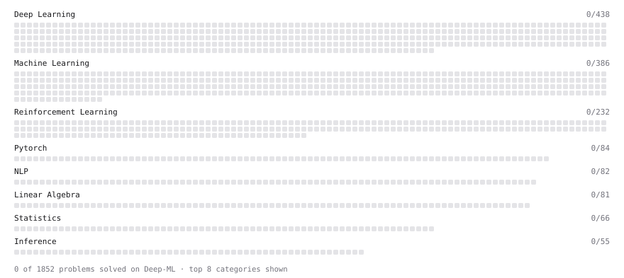

# Deep-ML

My machine learning practice from [Deep-ML](https://www.deep-ml.com). Every solution here was written by hand.

**16** solved · 0 problems · 0 labs · 16 math

[**Browse the interactive portfolio**](https://zhouzhuoyin1998-collab.github.io/deep-ml/) to replay this filling in over time.

## Math

| | Difficulty | Solved | |
| --- | --- | --- | --- |
| [Derivatives and Gradients](https://www.deep-ml.com/math-problems/1) | easy | 2026-10-29 | [solution](math/0001-derivatives-and-gradients) |
| [Gradient Descent Updates](https://www.deep-ml.com/math-problems/5) | easy | 2026-10-30 | [solution](math/0005-gradient-descent-updates) |
| [Matrix Basics](https://www.deep-ml.com/math-problems/9) | easy | 2026-10-29 | [solution](math/0009-matrix-basics) |
| [Odds, Log-Odds, and Reading Logistic Coefficients](https://www.deep-ml.com/math-problems/90) | easy | 2026-10-31 | [solution](math/0090-odds-log-odds-and-reading-logistic-coefficients) |
| [Vector Operations](https://www.deep-ml.com/math-problems/7) | easy | 2026-10-29 | [solution](math/0007-vector-operations) |
| [Why Minibatches: Gradient Variance vs Batch Size](https://www.deep-ml.com/math-problems/130) | easy | 2026-10-30 | [solution](math/0130-why-minibatches-gradient-variance-vs-batch-size) |
| [Common Distributions I: Bernoulli, Binomial, Uniform](https://www.deep-ml.com/math-problems/21) | medium | 2026-10-30 | [solution](math/0021-common-distributions-i-bernoulli-binomial-uniform) |
| [Inverse and Rank](https://www.deep-ml.com/math-problems/12) | medium | 2026-10-29 | [solution](math/0012-inverse-and-rank) |
| [Least Squares and the Normal Equations](https://www.deep-ml.com/math-problems/34) | medium | 2026-10-29 | [solution](math/0034-least-squares-and-the-normal-equations) |
| [Logistic Regression as Maximum Likelihood](https://www.deep-ml.com/math-problems/40) | medium | 2026-10-31 | [solution](math/0040-logistic-regression-as-maximum-likelihood) |
| [Matrix Multiplication](https://www.deep-ml.com/math-problems/10) | medium | 2026-10-29 | [solution](math/0010-matrix-multiplication) |
| [Multivariate Calculus](https://www.deep-ml.com/math-problems/2) | medium | 2026-10-29 | [solution](math/0002-multivariate-calculus) |
| [Orthogonality and Projections](https://www.deep-ml.com/math-problems/14) | medium | 2026-10-29 | [solution](math/0014-orthogonality-and-projections) |
| [Regularization and Generalization](https://www.deep-ml.com/math-problems/31) | medium | 2026-10-18 | [solution](math/0031-regularization-and-generalization) |
| [Solving Linear Systems](https://www.deep-ml.com/math-problems/13) | medium | 2026-10-29 | [solution](math/0013-solving-linear-systems) |
| [Matrix Decompositions: LU and QR](https://www.deep-ml.com/math-problems/15) | hard | 2026-10-29 | [solution](math/0015-matrix-decompositions-lu-and-qr) |

---

_This file is regenerated by Deep-ML on every push._
